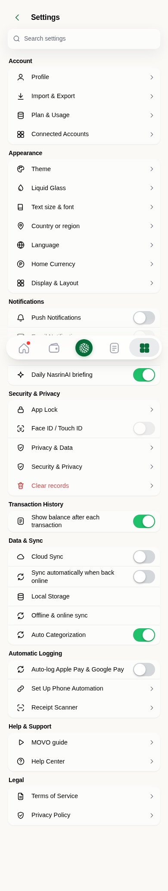
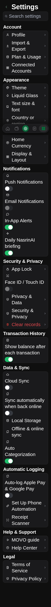
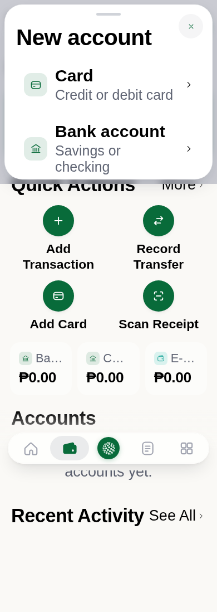

# MOVO iOS interface review — 2026-11-20

## Scope and result

The owner requested that buttons and panels follow the iOS interface rather than a fixed visual imitation. Existing React/Capacitor screens remain; shared presentation now consumes UIKit typography, semantic surfaces and accessibility settings. UIKit still provides native navigation bars, sharing and other existing platform services. Web buttons/sheets remain web components; this work does not replace the app with a new native navigation or financial architecture.

The source fixes are in [PR #330](https://github.com/nasrinaiv0/movo/pull/330). Do not infer deployment or signed-device approval from local verification. Vercel explicitly reports an overdue team balance (`402 resource_creation_blocked`); an accepted unpause request did not restore service. Account-owner billing resolution, hosted verification and new native acceptance are required.

## Findings and resolutions

| Finding | Resolution |
| --- | --- |
| Native title uses a fixed 22pt font; CSS uses a downloaded default font and app-only scaling | UIKit preferred headline/Dynamic Type; default installed-iOS font uses Apple's system stack. OS body text scale multiplies the existing app text setting. Custom fonts remain available. Scaled inputs retain a 16px minimum. |
| Native dock combines fixed button widths/heights with a constrained fill-equally stack | Dock buttons flex with their container and retain 44pt minimums; native header actions grow from 40pt to at least 44pt. Layout uses safe-area side anchors and live native header metrics. |
| Resolved light/dark is forced onto the iOS window even when the person selected System | New bridge capability preserves `.unspecified` for System, with resolved appearance changes refreshing UIKit semantic panel, field and separator colors. Old binaries retain their legacy bridge fallback. Explicit app themes remain overrides. |
| Native buttons do not mirror disabled web state; bridge failure can leave web controls hidden | Mirror disabled/back/tab state, block stale or modal-covered taps, discard superseded asynchronous icon payloads and hide web chrome only after native success. On failure retain web navigation and attempt to hide stale native bars. |
| Device Reduce Transparency and native selection motion do not consistently reach both surfaces | System material/opaque fallbacks, Reduce Motion on native selection and JavaScript transitions, plus CSS disabling repeated decorative motion. Bold Text and Increase Contrast update shared presentation. Hidden native bars leave accessibility traversal. |
| Panel sizing uses the full viewport while a keyboard may occupy part of it | Use live visual viewport height/offset plus safe-area bounds and scrolling; reserve native header height from actual text metrics. |
| Wallet action labels overlap at large text; long setting labels compete with switches | Size action columns from text and available width; permit setting rows to grow and wrap switches below labels. Step 3 shows the corrected two-column actions beneath the panel. |

## Verified coverage

- Node 26.13.1: **256 suites / 1,682 tests**; focused native bridge/interface/font tests: **23**. Tests cover stale settings responses, startup failure/late success, disabled/modal taps, system appearance refresh, viewport events/cleanup and platform isolation.
- Type checking, strict optimized production build, offline-worker integration, localization and email-template checks pass. The shell still prepares 229 resources.
- Isolated Chromium supplies the iOS presentation class/text-scale/viewport tokens to the built web interface. It does **not** emulate UIKit or a physical keyboard. **72 checks** cover Home, Profile, Settings, Appearance and Wallet plus compact-height panels at widths 320/390/844, light/dark and device text scales 1/1.6 combined with the existing 130% app setting (up to 208%). No horizontal page overflow or JavaScript page errors; tested Wallet action labels stay inside their buttons; close targets are at least 44×44 CSS pixels; panels fit a simulated 330px keyboard viewport.
- General web regression: **140** measurements across seven screens, five widths (320–1280), light/dark and default/130% text, no horizontal overflow or JavaScript errors. These checks are not proof that every individual control fits every possible string or accessibility size.

[Interface measurements](assets/2026-11-20-ios-interface/results.json) · [General responsive measurements](assets/2026-11-20-ios-interface/responsive-results.json)

## Inspected walkthrough

1. **Settings before the change — fixed presentation baseline.** Existing settings layout is intact, but app-only controls do not demonstrate system accessibility adaptation. This screenshot was freshly captured before editing. 
2. **Settings at large text in dark appearance — passing measured reflow.** At 320px and up to 208% combined scaling, rows grow and switches wrap below long labels. Some content remains lengthy and requires scrolling; physical assistive-technology acceptance remains. 
3. **Wallet and compact-height panel — passing measured containment.** The shared panel fits a 330px simulated keyboard viewport, the close target remains 44px, contents scroll, and underlying Wallet actions use two columns instead of overlapping labels. The full-page capture includes the page below the fixed overlay; that does not imply the underlying controls are active. 

## Preservation and remaining acceptance

No database schema, financial record/calculation, backend API, auth/storage security, pricing, entitlement or screen is replaced. The new native bridge API carries only ephemeral device presentation; values are not saved to account preferences. Existing owner-isolation, cleanup and financial tests remain intact. [Engineering record](../engineering/updates/2026-11-20-ios-system-interface.md).

New exact-head Apple compilation/simulator checks are required after publishing. Physical iPhone/iPad VoiceOver, native Dynamic Type at all accessibility categories, system theme changes while foreground/background, landscape notch/home-indicator geometry, actual keyboard/picker interactions, and older supported OS versions remain explicit acceptance. Apple Human Interface Guidelines and WCAG compliance cannot be certified from Chromium screenshots or source review. Device-specific controls should use the existing native bridge when a true OS control is required; do not add a separate hardcoded per-screen iOS skin.
