# MOVO PR #329 follow-up audit and remediation

November 20, 2026 UTC. Original audit retained at [full product audit](2026-11-20-full-movo-product-audit.md). This is the current follow-up, not a replacement for historical evidence.

## Outcome and release decision

PR #329 is closed because its complete accessibility/manifest changes were integrated into #327, squash-merged as main `73e293bf0889276111ce0537fa5500008546d203`. Do not reopen or duplicate it. This review fixes additional defects on existing [PR #330](https://github.com/nasrinaiv0/movo/pull/330); bounded development dependency remediation is isolated in [PR #331](https://github.com/nasrinaiv0/movo/pull/331).

Hold release. Fresh public requests return HTTP 402 with Vercel `DEPLOYMENT_DISABLED`; new PR checks report `Account is blocked`. Old READY deployment records and earlier HTTP 200 observations do not establish current availability. The account owner must resolve the provider restriction, then verify the deployed commit and hosted flows. This work does not change billing, bypass authentication or create a replacement deployment.

## Findings fixed in this candidate

| Priority | Reproduced gap | Resolution and evidence |
| --- | --- | --- |
| P0 | Clear records/account deletion used broad device-cache and file-store cleanup, beyond the current account's preference snapshot | Capture the confirmed owner's live/archive/offline file references before mutation. Clear its hybrid workspace, referenced receipts and owned QR namespace; preserve guest wallet, foreign workspace, encrypted read/chat cache, profile photo, active chat, consent, referral receipts and unassigned preference recovery. Keep SDK-managed auth keys out of wildcard deletion. App-level synthetic account A/B regression verifies foreign bytes/files survive and B's referenced files are removed. No ownership is assigned to unreferenced legacy blobs. |
| P1 | Selected local-file failures were swallowed and could be followed by a success message | Await selective cleanup and surface the existing failure notice; retain preferences when the file stage fails, and prove retry succeeds. Account switching invalidates stale reset/deletion completion. This does not make multi-stage cloud deletion atomic; resumable deletion remains #274/#291 acceptance work. |
| P1 | Navigation accessible names stayed English; translating labels would break pointer-cancel highlight matching | Translate existing labels and use stable screen targets for highlight restoration. Arabic RTL regression verifies accessible names and active Wallet after a cancelled press. No new catalogue strings or navigation structure. |
| P1 | Save relied on a parent amount draft that can lag behind the visible keypad expression | Submit the evaluated visible expression through the existing optional draft argument, with positive/finite/busy validation. A controlled delayed-parent regression fails on the old implementation and passes with the fix. Real UI writes and reloads exactly 7.66. No confirmed customer-ledger corruption is claimed. |
| P1 | Known development-tool advisories | #331 pins compatible patched serializer/underscore/SockJS UUID dependencies. Fresh registry audit: 31 to 19 total, 16 to 9 high; zero production findings before/after. No production dependency entries change. Remaining CRA-chain advisories are explicit follow-up. |

## Coverage, evidence and remaining acceptance

| Area | Verified in this review | Gap / recommended resolution |
| --- | --- | --- |
| UI/UX, settings, layout and adaptation | Seven screens across 320/390/430/768/1280 CSS px, light/dark and default/130% app text: 140 measurements, no horizontal page overflow or JavaScript page errors. Profile, Settings and Appearance retain current layout. | Actual Safari/WebKit, Firefox, browser zoom, foldables, safe areas and long real-world content remain device/browser acceptance. Width checks alone do not certify accessibility. |
| Buttons, keyboard and transitions | Actual guest expense entry/save; disabled empty Save; New Account open/Escape returns focus; setup heading focus, Tab containment, Terms return and acceptance at 320 px. Sheet timing measures 0.01 ms under reduced motion vs 200 ms otherwise. | VoiceOver/TalkBack and physical touch/microphone/audio/camera checks remain. Small visual icon bounds can have expanded pseudo-element hit areas; do not shrink/remove existing hit areas based on bounding boxes alone. |
| Calculations and accounting | 100.25 minus 12.34 = 87.91. New expense 7.66 persists and reloads to 80.25. Two-account fixture: total 97.91, cash 67.91 and bank 30.00 after internal transfer; pending 999 excluded. Automated financial suites include linked reversals, allocation, FX/rounding, credit/loan/receivable and sync contracts. | #328 finance migration was explicitly approved, applied and merged. Fresh catalog confirms authenticated direct transaction UPDATE/DELETE are denied. Store-delivered older-client acceptance remains separate; do not reapply migration history. |
| Functionality, architecture and recovery | 255 suites / 1,670 tests, type checking and strict production compilation pass on Node 26.13.1. Owner-session/race tests, import/sync and failure/retry regressions retained. | No framework, backend, financial schema, record shape, API payload, screen or CSS redesign. New cleanup helpers use existing keys/stores and introduce no database version upgrade. Integrate owner fixes into encryption/erasure branches only while preserving their stronger contracts. |
| Security, privileges and vulnerabilities | Read-only production metadata: 53/53 public tables have RLS; direct transaction UPDATE/DELETE denied; 15 authenticated-callable definer functions deny anonymous execution and configure search_path. Tests cover API/auth/data boundaries. | 24 no-policy tables are deliberate default-deny/internal surfaces, not permission to add broad policies. Definer functions still require per-call authorization review. Leaked-password advisor warning remains; sign-in is currently passwordless. No broad live grants/settings changed. |
| Privacy, compliance and erasure | Existing legal/setup disclosures retained. Cross-account cleanup preservation and visible file failure fixed. No real customer records read, written, exported or included in evidence. | #274 production owner-constraint/erasure/retention migrations still require their separate approval. Populated-account deletion, external-request handling and actual retention need acceptance. App Privacy, Play Data safety/financial declarations, operator/DPO and territory obligations need owner/legal validation against shipping behavior. No legal certification claimed. |
| Sharing, AI and permissions | Guest Friends correctly requires sign-in. Existing source/test boundaries retain opt-in sharing, owner/member checks, AI consent and MOVO context scope. | Two-account invitation/expiry/QR/pasted-link/share/revoke/block, cross-device consent withdrawal and OS sharing remain authenticated end-to-end gates. No real invites, messages or upstream AI requests sent. |
| Compatibility, native and paid access | Existing iOS and Android hosted builds passed on earlier #330 source. #274/#291 published heads have passing hosted checks. | New head requires fresh checks. Last published #330 paired R8 run failed Maven HTTP 429 after bounded retries; no emulator pass claimed. Signed encryption upgrade/key-loss/quota/rollback, native auth, stores/purchase/restore/refund and physical audio remain release gates. |
| Optimization and offline behavior | Optimized build prepares 229 offline shell resources. This candidate's main JS is about 1.50 MB raw / 437 kB gzip and main CSS 641 kB raw / 106 kB gzip. Bounded toolchain fixes validated separately. | Low-end cold-start/runtime measurements and intentional lazy loading remain; do not replace CRA or split critical offline surfaces without compatibility evidence. No performance certification from a local desktop build. |
| Release controls | Fresh GitHub query: main reports unprotected; visible repository rulesets list empty. Existing exact-head CI gates retained. | Administrator must review effective protection/required checks. No policy weakening or administrator changes performed. Vercel account restriction currently blocks hosted acceptance. |

## Screen walkthrough

These are synthetic guest records in isolated Chromium against the candidate production build at localhost. External requests were blocked; local API requests returned an explicit unavailable response. No real account or payment service was exercised. Each capture was visually inspected. Full-page screenshots can show page content beneath a fixed modal; that is not proof that keyboard focus can escape it.

1. **Home** — balance and summary content. 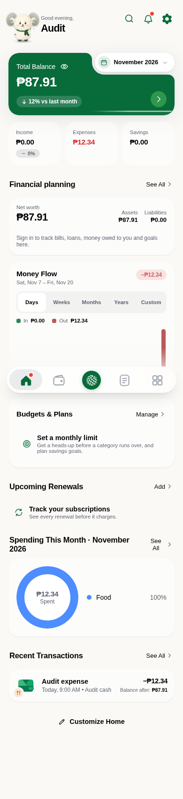
2. **Wallet** — account actions and consistent balance. 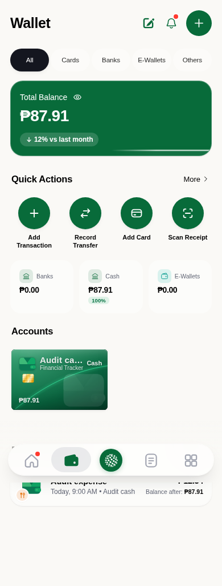
3. **Transactions** — amount, account and grouping. 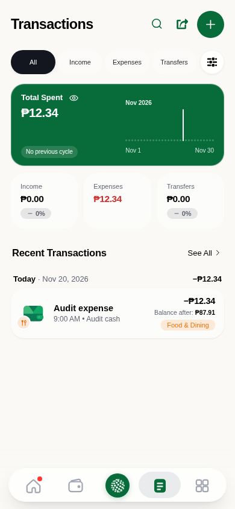
4. **Menu** — routes and combined plan entry. 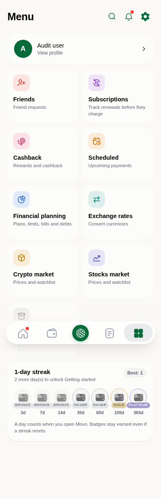
5. **Profile** — account identity and actions. 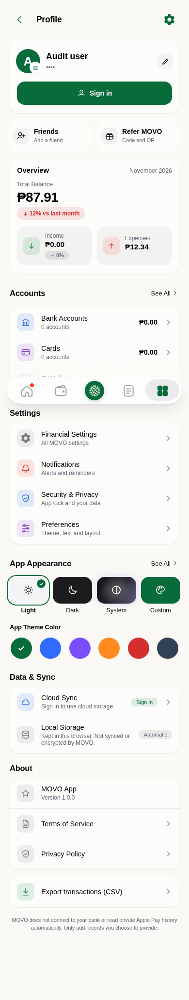
6. **Settings** — existing configuration routes. 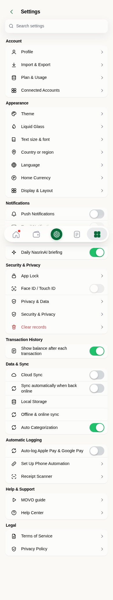
7. **Appearance** — theme/text controls. 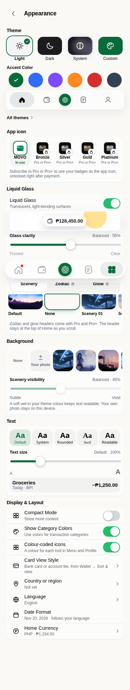
8. **Arabic Wallet** — RTL, 320 px and 130% text. 
9. **Expense entry** — visible keypad 7.66 before Save. 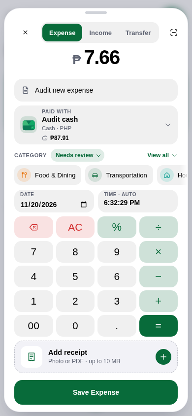
10. **Friends** — guest sign-in requirement. 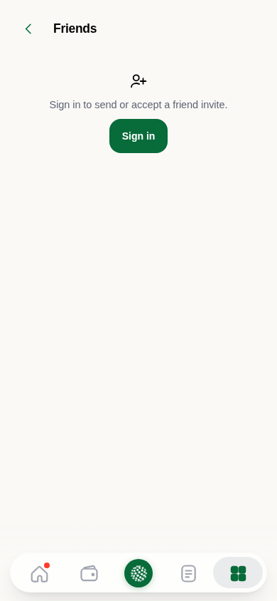
11. **Recent logs** — saved 7.66 and balance 80.25 after reload. 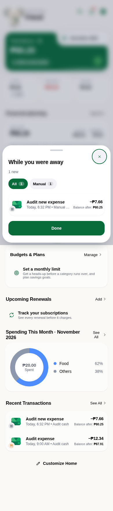
12. **Setup** — keyboard legal-link focus and scrollable acceptance at 320 px. 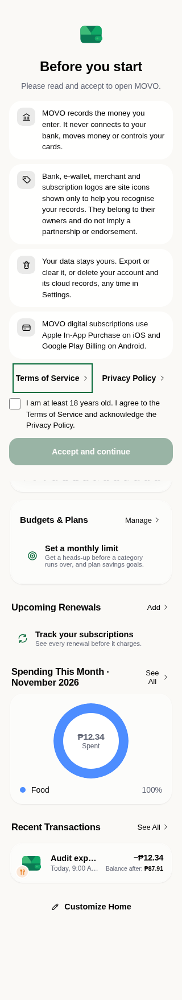

[Responsive measurements](assets/2026-11-20-pr329-followup/responsive-results.json) · [Interaction assertions](assets/2026-11-20-pr329-followup/functional-results.json)

## Explicit full-device recovery boundary

The passcode-recovery flow has a separately confirmed whole-device reset (`DELETE`), distinct from account-scoped Clear records. Its existing broad local/session-storage removal is not covered by the selective-cleanup proof. Verify file/native/cache completeness and recovery disclosures as a separate destructive-flow acceptance case; do not invoke it on a populated real device during this audit.

## Next execution

Resolve the Vercel account block; rerun exact-head checks and hosted legal/keyboard/motion flows. Validate disposable two-account device cleanup, integrate preserved-owner logic with #291 encryption/#274 resumable deletion, then complete their independent acceptance gates. Apply no #274 production migration without its specific approval. Retain the protected-preview access restriction and store/device gates. Merge only the resulting conflict-free green tree and verify production afterward.
