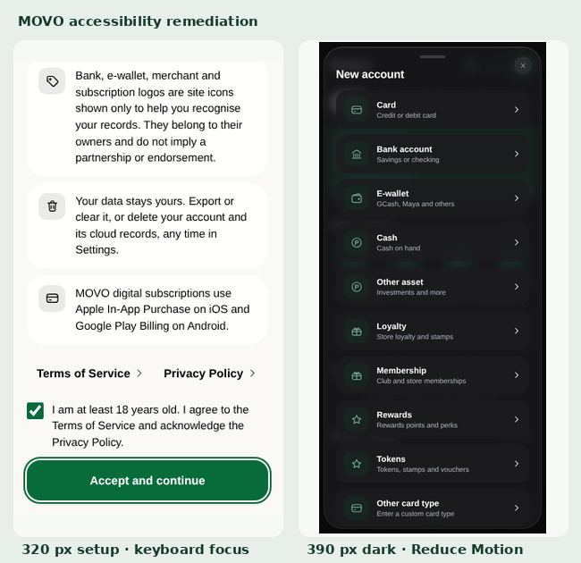

# MOVO audit remediation: setup focus, reduced motion and install identity

**November 20, 2026 · Asia/Manila**

- Purpose: publish the audited production findings and address the independent accessibility and branding defects that can be verified without changing financial state or store settings.
- Change: focus the Setup Agreement heading on entry. Dynamically wrap Tab and Shift+Tab among enabled controls. Mark the covered dashboard inert and hidden from assistive technologies while the gate is visible. Terms, privacy and account deletion retain their existing navigation and acceptance conditions.
- Change: apply the fast shared sheet and confirmation animation durations only with no reduced-motion preference. Existing reduced-motion styles handle the sheet and its children.
- Change: align the PWA installation title and short name with the approved MOVO identity.
- Paths: `src/App.js`, `src/components/SetupAgreement.js`, `src/components/SetupAgreement.test.js`, `src/App.css`, `public/manifest.json`.
- Validation: verify enabled and disabled control focus boundaries, wrap in both directions, cleanup, legal read/return, short viewport scroll, standard and reduced animation, mobile layout, PWA name, full Node 26 tests/typecheck/build and exact-head CI/Vercel status.
- Data and security: no schema, finance, account deletion, purchase, legal revision or entitlement change. The app hides only the covered content while the setup agreement is shown. Browser validation uses isolated state without customer accounts.
- Rollback: revert this PR. The source changes introduce no data migration or persistence-format change.
- Remaining gates: [product audit and release matrix](../../audits/2026-11-20-full-movo-product-audit.md). #326, #327, #328, #290, and #291 cover related branches. Shared-account preference migration, resumable deletion, production store configuration and physical-device acceptance remain open.

## Validation completed before commit

- The Node 26.13.1 strict production build passed 251 suites and 1,627 tests, including the new keyboard regression, plus TypeScript and the 229-file offline shell.
- Four isolated Chromium cases covered 320, 390 and 430 px, light and dark, and both motion preferences. Each passed heading focus, keyboard containment, a visible focused action, the Terms read-and-return path, small-screen access to acceptance, Escape and focus restoration, and the installed app name. The account sheet measured 0.01 ms under Reduce Motion and 200 ms with standard motion. No page errors or horizontal overflow were observed.
- These checks use synthetic state. Review hosted CI and Vercel against the submitted commit. A Claude review and physical-device VoiceOver/TalkBack were unavailable.

